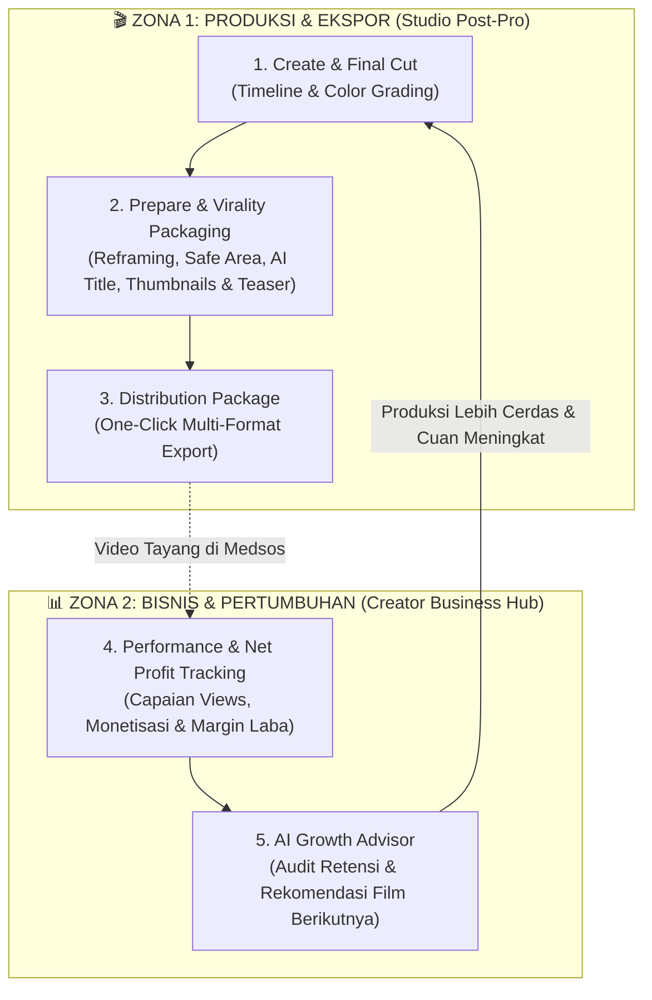

# 🚀 Master Plan V2: Publishing Hub, AI Virality Packaging & Creator Business Platform

> **Visi Inti:** *"AI Movie Factory bukan sekadar generator video dengan tombol upload. AMF adalah Ekosistem Produksi Film & Platform Bisnis Kreator AI dari ide, pasca-produksi, hingga menghasilkan audiens dan cuan nyata."*  
> **Prinsip Utama:** **Zero-Clutter UX** — Memisahkan dengan tegas antara persiapan rilis (*Pre-Release*) dan pengelolaan bisnis (*Post-Release*) agar pengguna tidak kewalahan.

---

## ⚖️ Evaluasi Kritis atas Review ChatGPT: Adopsi vs Rebuttal

| Poin Review ChatGPT | Keputusan & Analisis | Penerapan dalam Rencana V2 |
| :--- | :--- | :--- |
| **Pemisahan Pre-Release vs Post-Release** | **100% DIADOPSI (Sangat Tepat)** Kreator yang sedang merender video tidak boleh dijejali grafik analytics atau kalkulator profit rumit. | Membagi arsitektur menjadi 2 zona waktu: **Publishing Hub** (saat ekspor di Post-Pro) dan **Creator Business Hub** (setelah video tayang). |
| **Safe Area Preview (TikTok/Reels/Shorts)** | **100% DIADOPSI (Krusial)** Smart Crop otomatis sering terpotong oleh tombol UI TikTok/Reels di kanan dan caption di bawah. | Menambahkan grid overlay *Safe Zones* interaktif + slider geser posisi framing manual. |
| **AI Trailer & Teaser Factory (15s, 30s, 60s)** | **100% DIADOPSI (Game Changer)** Materi promosi video pendek jauh lebih mendongkrak penonton daripada sekadar teks hashtag. | AI memindai timeline untuk mengekstrak momen puncak (aksi/emosi) dan merakit teaser berirama cepat secara instan. |
| **Net Profit & Cost Tracker (Monetisasi Riil)** | **100% DIADOPSI (Edukasi Finansial)** Mencegah ekspektasi palsu. Penghasilan harus dikurangi biaya produksi (kredit AI & aset) untuk melihat laba bersih. | Menghadirkan *Profitability Simulator* (Proyeksi Pendapatan - Estimasi Biaya Pembuatan = Estimasi Laba Bersih & Margin %). |
| **Direct API OAuth Publishing YouTube/TikTok** | **REBUTTAL & PENYESUAIAN (Koreksi Teknis)** *Rebuttal:* Upload via 3rd party API sering terkena kuota ketat Google dan pembatasan algoritma TikTok (*shadowban*). | **Solusi Unggul (P0):** *1-Click Distribution Package* (Video siap tonton + SRT + Judul & Deskripsi tersalin ke clipboard). Direct OAuth tetap disiapkan sebagai opsi lanjutan (P2). |
| **Post-Publishing Full API Scraping Analytics** | **REBUTTAL & PENYESUAIAN (Privasi & Kuota)** *Rebuttal:* Meminta hak akses baca channel YouTube/TikTok pengguna sangat sensitif dan rumit dari segi audit privasi platform. | **Solusi Cerdas:** *Hybrid Milestone Logger* (Kreator cukup masukkan link video / capaian views, AI menganalisis performa dan memberikan rekomendasi aksi untuk film berikutnya). |
| **Banjir 6 Fitur Tambahan Sekaligus** | **REBUTTAL & PHASING (Cegah Feature Creep)** *Rebuttal:* Menggelontorkan 6 modul besar sekaligus akan membuat UI penuh dan membingungkan pengguna baru. | Kita terapkan pembagian prioritas ketat: **P0 (Kebutuhan Rilis Instan)** -> **P1 (Intelijen Bisnis)** -> **P2 (Media Kit & Kolaborasi Lanjutan)**. |

---

## 🔄 The New Creator Growth Flywheel (Siklus 5 Langkah)

---

## 🏛️ Arsitektur Lengkap: 2 Zona Pengalaman Pengguna

### ZONA 1: Studio Publishing Hub (Di dalam Tab `Publikasi` Menu Editing & Post-Produksi)
Fokus murni: **Mempersiapkan karya agar tampil sempurna dan siap merebut perhatian penonton.**

#### 1. Smart Reframing & Safe-Area Inspector
* **Multi-Aspect Ratio Presets:**
  * `16:9 Landscape 4K` (YouTube & Bioskop)
  * `9:16 Vertical` (TikTok, Reels, Shorts)
  * `2.39:1 CinemaScope` (Festival Film)
  * `4:5 Web Series` (Drama Mobile)
* **Safe-Zone Grid Toggle:** Tombol transparan yang memunculkan batas tombol 'Like', 'Komentar', dan teks caption TikTok/Reels di atas layar video sehingga teks subtitle dan wajah aktor tidak tertutup.
* **Manual X-Offset Slider:** Pengguna dapat menggeser posisi tengah potongan vertikal jika AI memotong subjek yang salah.

#### 2. AI Virality & High-CTR Packaging Studio
* **5 Formula Judul Pemicu Klik:**
  1. *Curiosity Gap* (Menimbulkan rasa penasaran tanpa spoiler).
  2. *High Tension / Conflict* (Fokus pada ancaman/taruhan cerita).
  3. *SEO Discovery* (Optimal dicari algoritma mesin pencari).
  4. *Emotional Hook* (Menyentuh simpati/emosi penonton).
  5. *Sinematik Bergengsi* (Gaya judul film festival).
* **AI Thumbnail Studio:**
  * Pilihan 3 frame paling dramatis hasil ekstraksi timeline.
  * Opsi *AI Composite Thumbnail* (menggabungkan ekspresi wajah karakter utama dengan latar belakang kontras tinggi).
  * Rekomendasi teks thumbnail (maksimal 3-4 kata punchy).
* **AI Trailer & 15-Detik Teaser Generator (Fitur P0 Baru):**
  * Memilih 3 adegan paling bertenaga dari timeline.
  * Menyusun video promosi kilat 15 detik berirama cepat dengan musik pemicu adrenalin untuk diposting sebagai konten pancingan.
* **Auto-Generated Deskripsi & Tag Tren:**
  * Sinopsis memikat, daftar cast/agen AI, timestamp chapter adegan, dan hashtag populer lintas platform.

#### 3. One-Click Distribution Packaging
* **Download Master Bundle (.zip):**
  * Video Master Resolusi Penuh.
  * Video versi Subtitle Sinematik.
  * File Subtitle `.SRT` dan `.VTT` (Bahasa Indonesia & Bahasa Inggris).
  * Salinan teks instan (Judul, Deskripsi, Hashtags, dan Timestamps) siap tempel ke YouTube Studio / TikTok Creator Center.

---

### ZONA 2: Creator Business & Growth Intelligence Hub (Halaman Khusus Pasca-Rilis)
Fokus murni: **Memahami performa, menghitung laba nyata, dan memperbesar channel kreator.**

#### 1. Profitability & Monetization Simulator
* **Estimasi Realistis Lintas Saluran (Bukan Janji Palsu):**
  * *YouTube AdSense Simulator:* Pilihan estimasi views (10rb, 100rb, 1jt) dengan indikator RPM terkalibrasi genre (Sci-Fi/Edukasi/Misteri).
  * *TikTok Creator Rewards:* Simulasi khusus video berdurasi di atas 1 menit.
  * *Rate Card Sponsorship:* Rekomendasi harga endorsement merek untuk integrasi produk dalam film AI.
  * *Penjualan Seri Berbayar (Pay-per-view):* Simulasi distribusi mandiri via platform monetisasi konten.
* **Net Profit Dashboard (Biaya Produksi vs Pendapatan):**
  $$\text{Net Profit} = \text{Total Estimasi Penghasilan} - \text{Biaya Pembuatan Film (Kredit AI + Produksi)}$$
  Menampilkan persentase margin keuntungan secara transparan, memberikan kejelasan finansial bagi kreator.

#### 2. AI Growth Advisor & Pacing Evaluator
* **Pre-Publishing Hook Analyzer:**
  * Memeriksa 15 detik pertama film: Apakah adegan pembuka cukup memikat untuk menghentikan jempol penonton agar tidak *scroll*?
* **Post-Publishing Performance Logger:**
  * Kreator dapat mencatat pencapaian views film mereka.
  * AI memberikan saran taktis: *"Film genre Misteri Anda menghasilkan views 3x lebih cepat dibanding Sci-Fi. Rekomendasi episode berikutnya: buat sekuel dengan durasi 3 menit dan pertajam konflik di menit pertama."*

---

## 📅 Roadmap Implementasi Bertahap

```mermaid
flowchart LR
    subgraph P0["🔥 SPRINT 1 (Prioritas Utama - Segera)"]
        T1["Reframing & Safe Area Overlay"]
        T2["AI Virality Packaging (Judul, Thumb, SEO)"]
        T3["AI 15s Teaser Generator"]
        T4["Master Distribution Package (.zip/SRT)"]
    end

    subgraph P1["⚡ SPRINT 2 (Intelijen Finansial)"]
        T5["Profitability Simulator (Revenue vs Cost)"]
        T6["Pre-Publishing Hook Analyzer"]
        T7["Milestone Growth Logger"]
    end

    subgraph P2["🚀 SPRINT 3 (Skala Lanjutan)"]
        T8["Creator Media Kit & Proposal Sponsor"]
        T9["Direct OAuth Publishing API"]
    end

    P0 --> P1 --> P2
```

